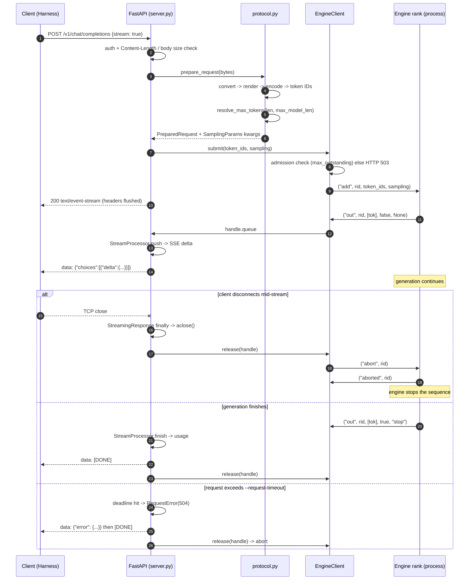

# Architecture

`deepinfer-bridge` exists because DeepInfer's first release is **offline only**: it has no
HTTP server, no KV-cache service, no prefill/decode disaggregation and no cross-replica
load balancing. DeepSeek Harness, on the other hand, speaks an OpenAI-compatible HTTP API.
The bridge supplies exactly that missing layer, and nothing more.

```text
 Harness (dsh)
      |  HTTP: POST /v1/chat/completions  (OpenAI schema)
      v
 +---------------------------------------------------------------+
 | FastAPI app  (deepinfer_bridge/server.py)                     |
 |   auth middleware -> admission -> per-request accounting      |
 +---------------------------------------------------------------+
      |                                    ^
      | bytes                              | SSE frames / JSON
      v                                    |
 +-----------------------+       +------------------------------+
 | protocol.py           |       | recipe StreamProcessor       |
 |  recipe ChatCompletion|       |  decode tokens -> thinking / |
 |  Request.convert      |       |  tool_calls / content, stop  |
 |  DeepseekV41Encoding  |       |  sequences, usage            |
 |  .encode -> token IDs |       +------------------------------+
 |  resolve_max_tokens   |                     ^
 |  build_sampling       |                     | recipe InferenceChunk
 +-----------------------+                     |
      | token IDs + SamplingParams kwargs      |
      v                                        |
 +---------------------------------------------------------------+
 | EngineClient  (engine_client.py)                              |
 |  one OS process per DP rank, least-outstanding routing,       |
 |  per-request asyncio.Queue, health, abort-on-release          |
 +---------------------------------------------------------------+
      | multiprocessing command queue      ^ multiprocessing event queue
      v                                    |
 +---------------------------------------------------------------+
 | one engine process per rank                                   |
 |   engine_real.py  -> DeepInfer LLMEngine (add_request/step)   |
 |   engine_mock.py  -> canned output, same IPC, no GPU          |
 +---------------------------------------------------------------+
```

## Why the process split matters

Two rules shape the design:

1. **The HTTP process must never import `torch` or `deepinfer`.** CUDA initialises on
   import, and per-rank `CUDA_VISIBLE_DEVICES` has to be set *before* that happens — inside
   each spawned worker. `tests/test_hardening.py::test_http_process_never_imports_torch_or_deepinfer`
   enforces this.
2. **The engine only ever sees token IDs.** All prompt rendering, special-token handling
   and output parsing happen through deepseek-recipe on the HTTP side, so behaviour matches
   DeepSeek's official API rather than a reimplementation of it.

## Sequence: one streamed request, including a client disconnect



## IPC protocol

Between `EngineClient` and one engine process, over `multiprocessing` queues (spawn context):

| Direction | Message | Meaning |
|---|---|---|
| HTTP → rank | `("add", rid, token_ids, sampling)` | enqueue a request |
| HTTP → rank | `("abort", rid)` | cancel a request |
| HTTP → rank | `("stop",)` | exit the loop and tear the engine down |
| rank → HTTP | `("ready", rank, info)` | rank finished loading |
| rank → HTTP | `("out", rid, tokens, finished, reason)` | one step's tokens |
| rank → HTTP | `("aborted", rid)` | abort acknowledged |
| rank → HTTP | `("fatal", rank, traceback)` | rank died; the bridge goes unhealthy |

`daemon=False` is deliberate: DeepInfer workers spawn their own children, which a daemon
parent cannot do. This mirrors `examples/_launch.py`.

## Lock-step with DP > 1

`LLMEngine.has_unfinished_requests()` performs an `all_reduce(MAX)` across the data-parallel
group (only when that group is larger than one), and `step()` contains attention-DP and
MoE-EP collectives. Every rank must therefore execute the same call sequence in the same
order, forever — even when it has no local work.

The serving loop in `engine_real.py` is:

```text
drain command queue (local only, no collectives)
if engine.has_unfinished_requests():   # all-reduced -> every rank agrees
    outputs = engine.step()            # collective
    need_flush = True
elif need_flush:
    outputs = engine.flush_inflight_reqs()   # collective
    need_flush = False
else:
    sleep(2 ms)
```

Because the `has_unfinished_requests()` result is identical on every rank, `need_flush`
stays in step across ranks without any extra signalling: all ranks step together and all
ranks flush together. This is the same shape as the reference drain loop in
`deepinfer/entrypoints/llm.py::_run_engine`. It has not been executed on hardware.

Consequences worth knowing:

- Idle ranks poll. They cannot block on a condition variable, because the collective is the
  only synchronisation.
- Workers must **restart together**. Restarting one rank in isolation would leave the
  survivors blocked inside a collective.
- Shutdown sends `("stop",)` to every rank and joins them all.

## Request accounting

Every request gets one `RequestStats`, finalised exactly once (`_finalize`) on every exit
path — success, error, timeout or disconnect. It emits one structured log line and updates
`/metrics`. The `deepinfer_bridge_in_flight` gauge is deliberately **not** clamped at zero,
so a double-finalise shows up as a negative value instead of hiding.

## Metrics

`metrics.py` implements counters, gauges and fixed-bucket histograms and renders the
Prometheus text exposition format by hand. This avoids a `prometheus_client` dependency and
its version-pinning risk in the release matrix. Labels are validated on every write, so a
typo raises immediately rather than silently creating a stray series.
